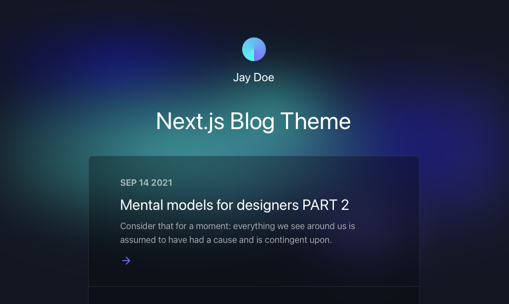

# nextjs-blog-theme

A personal copy of the [Netlify Next.js blog template](https://github.com/netlify-templates/nextjs-blog-theme), designed by [Bejamas](https://bejamas.io). It is a small blog: posts are MDX files in `posts/`, pages are built with Next.js and styled with Tailwind CSS, and there is a light and dark mode.



Upstream demo: <https://bejamas-nextjs-blog.netlify.app>

## What it contains

- Next.js 16 (Pages Router), React 19, Tailwind CSS 4 with `@tailwindcss/typography`.
- MDX posts rendered with `next-mdx-remote`, with GitHub-flavored Markdown (`remark-gfm`) and Prism code highlighting.
- A home page that lists posts newest first (`pages/index.js`) and a post page with previous and next links (`pages/posts/[slug].js`).
- Light and dark mode, set with the toggle in the footer and saved in `localStorage`. A first visit starts in light mode whatever the OS setting. The page follows the OS only when that setting changes while the page is open (`components/Layout.js`), and it saves that change too.
- Five color themes and three font stacks (`themes.js`), picked with environment variables.
- Five example posts in `posts/`.
- `netlify.toml` for a Netlify build (`npm run build`, publish `.next`).

## Status

This repo is the upstream template as of January 2026 plus dependency security overrides in `package.json`. It has no tests.

Fixed in this revision:

- The `js-yaml` security override put js-yaml 4 under `gray-matter`, which calls `yaml.safeLoad` (removed in js-yaml 4), so every page that reads posts returned a 500 and `npm run build` failed. `gray-matter` now gets the patched 3.x line (`^3.14.2`); everything else keeps `>=4.2.0`.
- `package-lock.json` is back in sync, so `npm ci` works.
- The `lint` and `export` scripts called `next lint` and `next export`, which Next.js 16 removed. Both scripts were dropped; `next build` already writes the static pages.

Still open: `npm run dev:watch` serves the site but does not reload it. When a file in `posts/` changes, `next-remote-watch` 2.0.0 throws `TypeError: Cannot read properties of undefined (reading 'send')`, because it calls `app.server.hotReloader`, which Next.js 16 does not expose. Use `npm run dev` and refresh the page.

CI (`.github/workflows/ci.yml`) runs `npm ci` and `npm run build` on every push to `main` and every pull request.

## Running it locally

The lockfile is for npm.

```shell
npm ci
npm run dev
```

Then open <http://localhost:3000>. After editing a post, refresh the page. `npm run build` and `npm start` build and serve the production site.

## Configuring the blog

Settings come from environment variables, read when the pages are built. `.env.example` lists them; copy it to `.env.local` to override the defaults:

| Variable | What it sets | Default |
| --- | --- | --- |
| `BLOG_NAME` | Name in the header and in page titles | `Jay Doe` |
| `BLOG_TITLE` | Main heading (`h1`) on the home page | `Next.js Blog Theme` |
| `BLOG_FOOTER_TEXT` | Footer text | `All rights reserved.` |
| `BLOG_THEME` | Color theme: `default`, `bejamas`, `netlify`, `reddie`, `greenie` | `default` |
| `BLOG_FONT_HEADINGS` | Font for headings: `sans-serif`, `serif`, `monospace` | `sans-serif` |
| `BLOG_FONT_BODY` | Font for everything else, same options | `sans-serif` |

The upstream README calls the last one `BLOG_FONT_PARAGRAPHS`; the code reads `BLOG_FONT_BODY`.

To change the defaults in code instead, edit `utils/global-data.js` (name, title, footer) and `utils/theme-utils.js` (theme and fonts). The color and font values live in `themes.js`.

## Adding posts

Add a `.mdx` file to `posts/`. The file name becomes the URL (`posts/my-post.mdx` is served at `/posts/my-post`). Front matter fields:

```yaml
---
title: My post
description: One line shown on the home page and under the post title.
date: '2026-01-31'
---
```

MDX files cannot use `import`. To use a React component in a post, add it to the `components` object in `pages/posts/[slug].js`. Links and images are already mapped to `components/CustomLink.js` and `components/CustomImage.js`.

## Dependency updates

Dependabot (`.github/dependabot.yml`) opens weekly npm updates and monthly GitHub Actions updates. The upstream `renovate.json`, which pointed at the `netlify-templates` preset, was removed.

## License

MIT, see [LICENSE](LICENSE). The template is by Bejamas and Netlify (see `package.json` for contributors).
